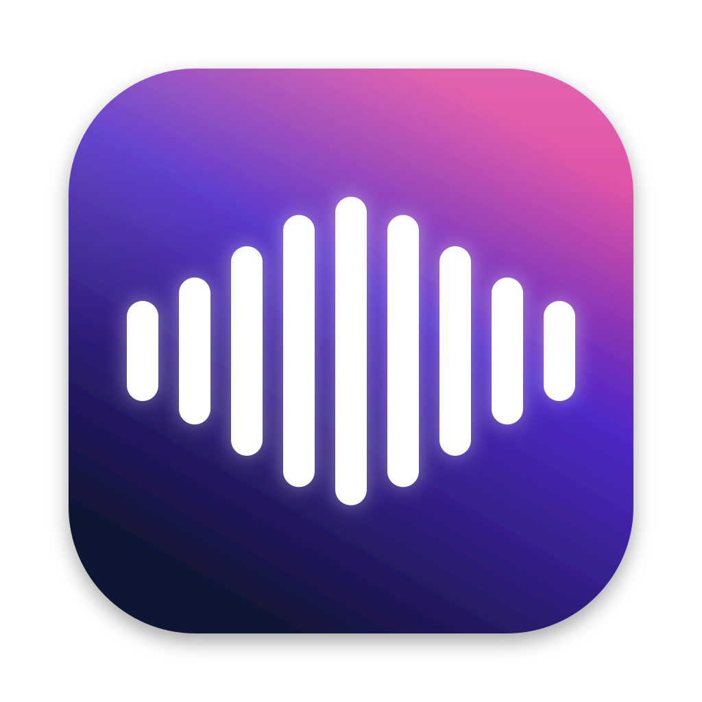

<p align="center"></p>

<h1 align="center">Flüster für Windows</h1>

<p align="center">
  <a href="#installation"><b>Installieren</b></a> ·
  <a href="#einrichten">Einrichten</a> ·
  <a href="#bedienung">Bedienung</a> ·
  <a href="#häufige-probleme">Hilfe</a> ·
  <a href="../README.md">Alle Systeme</a>
</p>

---

Du hältst **Strg rechts**, sprichst und lässt los. Der Text landet sauber formuliert dort, wo dein Cursor steht: in WhatsApp, Outlook, Teams, Word, im Browser oder im Terminal. Die Erkennung läuft kostenlos und offline auf deinem PC. Mit Grafikkarte geht sie besonders schnell.

> **Warum nicht Fn?** Die Fn-Taste von Windows-Tastaturen erreicht das System nicht, sie wird in der Tastatur selbst ausgewertet. Flüster nimmt deshalb standardmäßig **Strg rechts**. Alternativ gehen **Strg + Win**, die **Feststelltaste**, **Alt rechts** oder **F8**.

## Installation

**Du brauchst:** Windows 10 (ab Version 1809) oder Windows 11, 64 Bit. Dazu rund 1 GB Platz für App und Modell. Administratorrechte sind nicht nötig.

### Weg A: ein Befehl (empfohlen)

1. **PowerShell** öffnen: Startmenü öffnen, „PowerShell“ tippen, Enter.
2. Diese Zeile einfügen und Enter drücken:

   ```powershell
   irm https://raw.githubusercontent.com/KimJongUnNK/fluester/main/scripts/install.ps1 | iex
   ```

3. Fertig. Flüster liegt jetzt in `%LOCALAPPDATA%\Programs\Fluester`, steht im **Startmenü** und startet sofort.

### Weg B: manuell

1. **[Fluester-Windows-x64.zip herunterladen](https://github.com/KimJongUnNK/fluester/releases/latest/download/Fluester-Windows-x64.zip)** (ca. 70 MB).
2. Die ZIP mit Rechtsklick › **Alle extrahieren** entpacken, zum Beispiel nach `Dokumente\Flüster`.
3. **Fluester.exe** starten.
4. Meldet sich **„Der Computer wurde durch Windows geschützt“**, klick auf **„Weitere Informationen“** und dann auf **„Trotzdem ausführen“**. Flüster ist nicht kostenpflichtig signiert, deshalb kennt SmartScreen die App nicht. Mit Weg A erscheint diese Meldung nicht.

---

## Einrichten

> **Flüster hat kein Fenster in der Taskleiste.** Es sitzt unten rechts im **Infobereich** (neben der Uhr, eventuell unter dem Pfeil **^**). Ein Linksklick öffnet die Einstellungen, ein Rechtsklick das Menü.

Beim ersten Start öffnet sich die Einrichtung:

1. **Mikrofon:** Steht dort „gesperrt“, auf **Datenschutz öffnen** klicken und **„Desktop-Apps den Zugriff auf das Mikrofon erlauben“** einschalten.
2. **Diktat-Taste:** **Strg rechts** ist voreingestellt und stört beim Tippen am wenigsten.
3. **Erkennung:** Bei **Large v3 Turbo** auf **Laden** klicken. Das sind 547 MB und passiert nur einmal. Hast du einen älteren PC ohne eigene Grafikkarte, nimm **Small**.
4. **Ausprobieren:** Ins Feld klicken, **Strg rechts halten**, sprechen, loslassen. Dann auf **„Los geht's“** klicken.

Flüster startet ab jetzt mit Windows. Das lässt sich unter **Einstellungen › Allgemein › „Mit Windows starten“** ändern.

---

## Bedienung

| Was | Wie |
| --- | --- |
| Diktieren | **Strg rechts halten** → sprechen → loslassen |
| Freihändig | **Strg rechts doppelt tippen** → sprechen → **einmal tippen** zum Beenden |
| Command Mode | Text markieren → **Strg rechts + Umschalt halten** → „mach das förmlicher“ |
| Abbrechen | **Esc** |
| Zeilenumbruch | „neue Zeile“, „neuer Absatz“ |
| Korrigieren | „um 3, ich meine um 4“ → „um 4“ · „streich das“ |
| Liste | „erstens Milch, zweitens Brot, drittens Eier“ |
| Letztes Diktat nochmal | Rechtsklick aufs Symbol › „Letztes Diktat erneut einfügen“ |

Während du sprichst, zeigt unten in der Bildschirmmitte eine schwarze **Leiste** die Wellenform. Danach siehst du dort kurz, wie viele Wörter eingefügt wurden.

### Erkennung
Zu finden unter **Einstellungen › Erkennung**:
- **Whisper lokal:** kostenlos, offline, versteht auch Deutsch-Englisch-Mix. Mit **„Grafikkarte nutzen (Vulkan)“** rechnet die Grafikkarte, egal ob NVIDIA, AMD oder Intel. Fehlt eine passende Karte, nimmt Flüster automatisch den Prozessor.
- **Cloud (Groq/OpenAI):** am schnellsten. Den Groq-Schlüssel gibt es kostenlos auf [console.groq.com/keys](https://console.groq.com/keys).

### KI-Bereinigung
Zu finden unter **Einstellungen › KI-Bereinigung**:
- **Nur Regeln** ist voreingestellt und arbeitet sofort und offline: Füllwörter raus, Selbstkorrekturen, Listen, Satzzeichen.
- **Sprachmodell:** Groq (gratis), OpenAI oder **Ollama** komplett lokal ([ollama.com](https://ollama.com), danach `ollama pull qwen2.5:7b`). Damit klingt der Text noch runder, und der **Command Mode** wird möglich.

### Wörterbuch, Textbausteine, Stile
Das funktioniert genau wie auf dem Mac:
- **Wörterbuch:** Namen richtig schreiben, zum Beispiel „Wispr Flow“ für „Whisperflow“.
- **Textbausteine:** „meine Adresse“ wird zur ganzen Adresse.
- **Stile:** locker in WhatsApp, förmlich in Outlook.

---

## Aktualisieren und entfernen

**Aktualisieren:** den Installationsbefehl aus [Weg A](#weg-a-ein-befehl-empfohlen) nochmal ausführen. Einstellungen, Verlauf und Modelle bleiben erhalten.

**Entfernen:** **Einstellungen › Apps › Installierte Apps › Flüster › Deinstallieren**. Oder in PowerShell:
```powershell
& ([scriptblock]::Create((irm https://raw.githubusercontent.com/KimJongUnNK/fluester/main/scripts/install.ps1))) -Uninstall
```
Einstellungen und Verlauf liegen in `%APPDATA%\Fluester`, die Modelle in `%LOCALAPPDATA%\Fluester`. Diese Ordner kannst du danach von Hand löschen.

---

## Häufige Probleme

**In einem bestimmten Programm passiert nichts.**
Läuft das Programm **als Administrator** (zum Beispiel eine Admin-Eingabeaufforderung), blockiert Windows Eingaben von normalen Programmen. Starte das Programm ohne Adminrechte. Der Text liegt trotzdem in der Zwischenablage, Strg+V reicht.

**Es wird nichts eingefügt, aber die Leiste zeigt Wörter.**
Manche Felder nehmen kein Strg+V an. Stell dann unter **Einstellungen › Allgemein › Einfügen** die Methode auf **„Tippen“**. Jedes Diktat liegt außerdem im **Verlauf**.

**„Mikrofon gesperrt“.**
Öffne **Windows-Einstellungen › Datenschutz und Sicherheit › Mikrofon** und schalte dort **„Desktop-Apps den Zugriff erlauben“** ein. Mit **Einstellungen › Allgemein › Mikrofon prüfen** testest du es.

**Falsches Mikrofon.**
Wähl unter **Einstellungen › Allgemein › Mikrofon** den richtigen **Eingang**.

**Die Erkennung ist langsam.**
Prüf unter **Einstellungen › Erkennung**, ob „Grafikkarte nutzen“ an ist. Dort steht auch, ob gerade die Grafikkarte oder der Prozessor rechnet. Ohne Grafikkarte nimmst du das Modell **Small**, oder du schaltest auf **Groq**.

**Die Feststelltaste schaltet trotzdem um.**
Das sollte sie nicht, Flüster schluckt die Taste. Passiert es trotzdem, nimm eine andere Taste, zum Beispiel Strg rechts.

**Der Virenscanner meldet Flüster.**
Flüster liest die Tastatur systemweit, damit die Diktat-Taste überall funktioniert. Manche Scanner schlagen deshalb vorsorglich an. Der komplette Quellcode liegt in diesem Repo, und jede Version wird automatisch auf GitHub gebaut.

**Etwas anderes geht nicht.**
Unter **Einstellungen › Über Flüster › Protokoll öffnen** siehst du die letzten Meldungen. Schick sie in einem [Issue](https://github.com/KimJongUnNK/fluester/issues) mit.

---

## Datenschutz

- Mit **Whisper lokal** und **Regeln** oder **Ollama** verlassen weder Ton noch Text deinen PC.
- API-Schlüssel sind mit Windows-DPAPI verschlüsselt, nur dein Windows-Konto kann sie lesen.
- Verlauf und Einstellungen liegen nur lokal in `%APPDATA%\Fluester`.
- Kein Konto, kein Tracking.

---

## Selbst bauen

Du brauchst das [.NET 10 SDK](https://dotnet.microsoft.com/download).

```powershell
git clone https://github.com/KimJongUnNK/fluester.git
cd fluester
dotnet test dotnet/Fluester.Core.Tests                    # gemeinsame Logik (auch unter Linux/macOS)
dotnet run --project windows/Fluester.Windows             # App starten
./scripts/package-windows.ps1 -Version 1.2.3 -Out dist    # Paket wie im Release
dist\win-x64\Fluester.exe --selftest                      # Selbsttest
```

**Aufbau:**
- `dotnet/Fluester.Core`: Textbereinigung, Wörterbuch, Stile, Prompts, Gesten, Audio und API. Die Logik ist dieselbe wie auf dem Mac und mit Tests abgedeckt.
- `dotnet/Fluester.Engine`: Whisper.net (whisper.cpp), Cloud, Bereinigungsablauf, Speicher.
- `windows/Fluester.Windows`: Tray-App mit Tastatur-Hook (WH_KEYBOARD_LL), WASAPI-Aufnahme, Einfügen per SendInput, Flow-Leiste, Einstellungen und Einrichtung.

## Stand

Die CI prüft jede Version automatisch auf Windows:
- Tastatur-Hook
- Einfügen per Strg+V und per Tippen in ein echtes Textfeld
- DPAPI und Autostart
- echte Spracherkennung mit Whisper
- Installer

Von Hand auf einem echten Windows-PC wurde Version 1.1 noch nicht getestet. Rückmeldungen in den [Issues](https://github.com/KimJongUnNK/fluester/issues) helfen.
